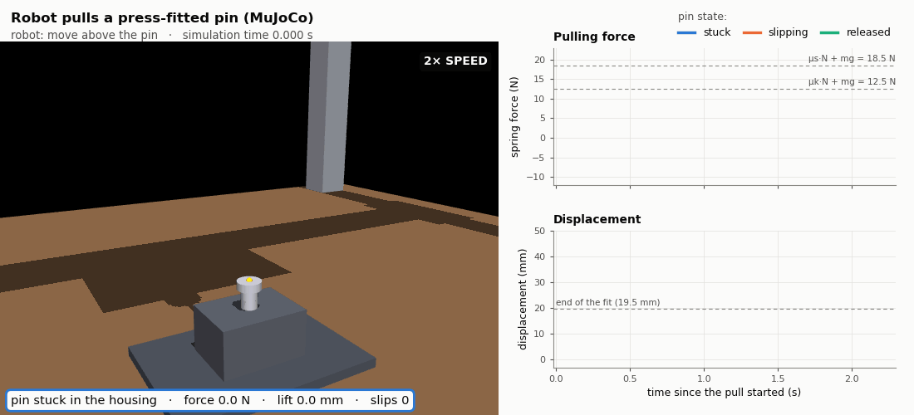
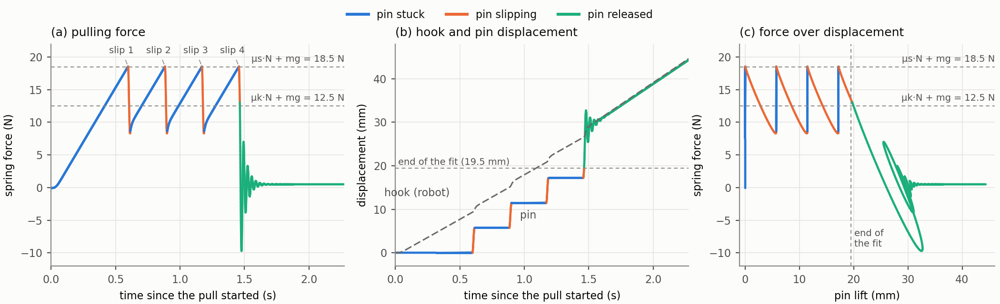
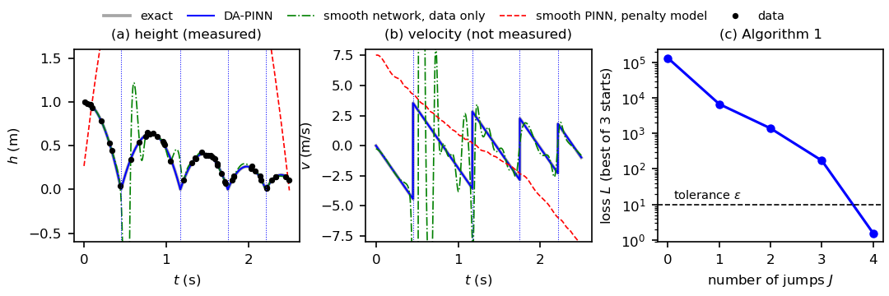
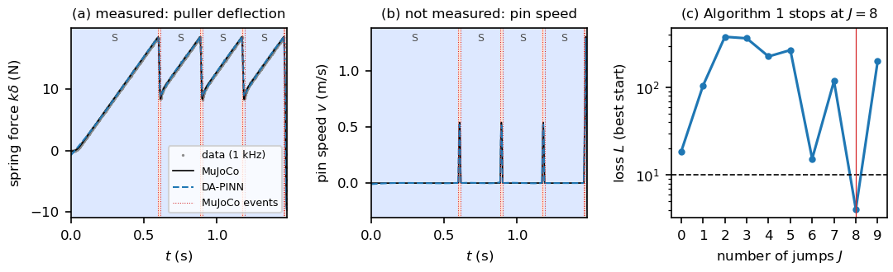
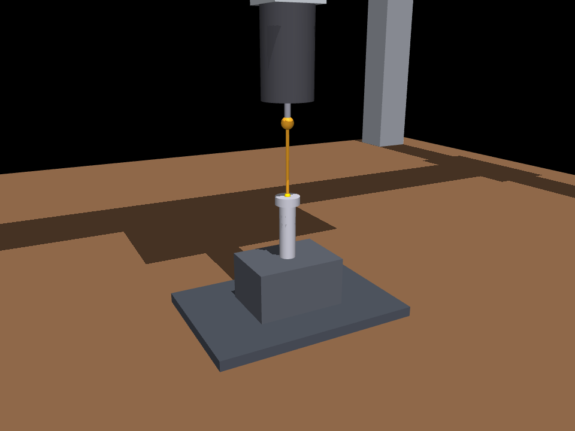

# Hybrid Surrogates for Hybrid Dynamical Systems

Code for the paper *Hybrid Surrogates for Hybrid Dynamical Systems:
Physics-Informed Learning Across Discontinuities*.

A **DA-PINN** (discontinuity-aware physics-informed neural network) puts one
small network on each flow interval of a hybrid system. It trains the
networks, the jump times and the physical parameters θ together, on the data
and on the flow, guard and reset conditions of the known physics. Algorithm 1
of the paper chooses the number of jumps and the guard that triggers each one.

This repository has both experiments of the paper:

1. **Bouncing ball.** The exact solution is known. The reset `v⁺ = −e v` is not
   the identity.
2. **Robotic disassembly.** A gantry robot pulls a press-fitted pin out of a
   housing in MuJoCo. The pin sticks and slips, and the slip mode has two
   guards, so Algorithm 1 must also choose how each slip ends.



*The MuJoCo simulation (left) with the pulling force and the displacements
(right), drawn as the simulation runs. The pin sticks (blue) until the force
reaches the static friction, slips (orange) for 17 ms, and sticks again. On
the fourth slip it leaves the fit (green) and rings on the spring. Slips are
shown 20× slower. The same video as MP4: [media/pin_extraction.mp4](media/pin_extraction.mp4).*

---

## Results

| | Bouncing ball | Press-fitted pin (MuJoCo) |
|---|---|---|
| Unknown θ | restitution `e` (true 0.8) | friction `μs`, `μk` (true 0.45, 0.30) |
| Events found by Algorithm 1 | J = 4 impacts, for all 3 noise seeds | J = 8, modes `S K S K S K S K R` (the true sequence) |
| Event-time error | 1.1 ± 0.6 ms (largest per seed) | ≤ 1.1 ms (all 8 events) |
| θ estimated | e = 0.7994 ± 0.0010 (0.1 %) | μs = 0.4495 (−0.1 %), μk = 0.3052 (+1.7 %) |
| Rel. L² error, measured state | 0.5 % (height) | 1.1 % (spring deflection) |
| Rel. L² error, **unmeasured** velocity | 11 % | 7.5 % |
| Smooth baselines | data-only net: 0–1 impacts instead of 4; penalty PINN: loss 1.2 × 10⁶ | — |

### Force and displacement of the pull



The robot raises the hook at a constant 20 mm/s (dashed line in b). While the
pin is stuck, the spring stretches and the force rises linearly (a). At
μs·N + mg = 18.5 N the pin breaks away and jumps 5.7 mm in 17 ms (b). The
force then drops to 8.3 N, below the kinetic level, and the pin sticks
again. After four slips the pin is out of the 19.5 mm fit and follows the
hook. Panel (c) is the extraction curve that a force sensor and an encoder on
the puller would record. Vector version: [media/pin_force_displacement.pdf](media/pin_force_displacement.pdf).

### DA-PINN fits

| Bouncing ball | Press-fitted pin |
|---|---|
|  |  |

For the pin, the loss is not monotone in J (right panel). The structures in
between put the right physics on the wrong sequence of events. J = 8, with an
*arrest* at the end of the first three slips and an *exit* at the end of the
fourth, is the first structure below the tolerance ε = 10.

---

## Quick start

Python 3.13, on one machine:

```bash
pip install -r requirements.txt
python3 run_all.py            # everything, ~25 min on 8 cores
```

or step by step:

```bash
cd pin_extraction
python3 pin_experiment.py --picture   # MuJoCo pull -> data/pin.npz              (~1 s)
python3 make_media.py                 # GIF, MP4, force/displacement graphs       (~15 s)
python3 make_submission_video.py      # 1-min 1080p MP4 with captions and credits  (~75 s)
python3 dapinn_pin.py                 # DA-PINN + Algorithm 1 on the pin          (~7 min, 7 processes)
python3 dapinn_pin.py --plot-only     # table and figure from saved results

cd ../bouncing_ball
python3 run_ball.py                   # DA-PINN + 2 baselines, 3 noise seeds      (~15 min, 1 thread)
python3 run_ball.py --plot-only       # table and figure from saved results
```

`make_media.py` writes the MP4 only if `ffmpeg` is on the PATH. The GIF and
the graphs need only Matplotlib and Pillow.

**Reproducibility.** Seeds are fixed, PyTorch runs in double precision with
deterministic algorithms, and every DA-PINN training uses one CPU thread. With
the pinned versions in `requirements.txt` (NumPy 2.4.3, PyTorch 2.9.1,
Matplotlib 3.10.8, MuJoCo 3.14.0), a run on the same machine reproduces the
paper's numbers. The MuJoCo simulation is deterministic: `make_media.py`
runs it twice and checks that both runs are identical, step for step.

---

## Repository layout

```
dapinn.py                 the DA-PINN: interval networks, the loss (data + flow + guard + reset),
                          training (Adam then L-BFGS), Algorithm 1
run_all.py                runs everything below, in order
bouncing_ball/
  run_ball.py             hybrid family of the ball, DA-PINN, two smooth baselines, table, figure
  results/                ball.json (every number), ball_curves.npz, ball_table.tex
  figs/                   ball_dapinn.pdf / .png
pin_extraction/
  scene_pin.xml           MuJoCo cell: table, 3-axis gantry robot, series-elastic puller (a tendon spring)
  device_pin.xml          the housing and the press-fitted pin (slide joint with friction)
  sim_utils.py            FrictionLaw (static > kinetic friction), engage(), motion profiles
  pin_experiment.py       robot program; records every physics step (4 kHz) -> data/pin.npz
  make_media.py           the video (GIF, MP4) and the force/displacement graphs
  make_submission_video.py  the one-minute supplementary video (1080p MP4, captions, anonymous credits)
  dapinn_pin.py           hybrid family of the pin (modes S, K, R), Algorithm 1 in parallel, table, figure
  data/pin.npz            the recorded pull, with hidden states and true events
  results/                pin.json (every number), pin_curves.npz, pin_table.tex, pin_summary.json
  figs/                   pin_dapinn.pdf / .png
media/                    pin_extraction.gif / .mp4, pin_force_displacement.png / .pdf, pin_cell.png
```

---

## Experiment 1: bouncing ball

State `ξ = (h, v)`, one mode, flow `ḣ = v, v̇ = −g`, guard `γ = h`, reset
`(h, v) ↦ (h, −e v)`. The ball is dropped from 1 m with `e = 0.8` and hits the
ground four times in `T = 2.5 s`. Only the height is measured, at 50 random
times with 1 cm noise. Unknown: `e`, the number of impacts, the impact times,
the initial state and the velocity.

The two baselines each use **one smooth network** on `[0, T]` (Proposition 1
of the paper): a pure data fit, and a PINN with the penalty contact model
`ḧ = −g + k[−h]₊ − c ḣ 1[h < 0]`. Neither can represent the velocity jumps.

## Experiment 2: robotic disassembly, extraction of a press-fitted pin



**The cell.** A gantry robot with three prismatic axes, each driven by a
position servo (the vertical axis: 10⁴ N/m, 160 N s/m), pulls a 50 g steel pin
out of a housing. It pulls through a **series-elastic puller**: a hook
connected to the pin by a spring (k = 2000 N/m, c = 2 N s/m) that measures its
own deflection δ. The hook rises at a constant 20 mm/s. The interference fit
presses on the pin with N = 40 N over L = 19.5 mm, with μs = 0.45 and
μk = 0.30. The time step is 0.25 ms.

**What is MuJoCo and what is Python.** MuJoCo simulates the robot axes,
gravity, the friction constraint of the pin's slide joint, and the puller
spring. The spring is a tendon, so MuJoCo applies exactly k and c as a
passive force. MuJoCo has **one** friction value per joint, so `FrictionLaw`
in `sim_utils.py` switches it between μs N (pin at rest, below 0.3 mm/s) and
μk N (sliding, above 1 mm/s), and sets it to 0 once the pin has left the fit.
The breakaway and the arrest themselves come from MuJoCo's friction
constraint. `FrictionLaw` only notices them, and logs every switch as a true
event for evaluation.

**The simulated pull.** The pin breaks away four times, at 18.5 N and every
0.29 s. Each slip lasts 17 ms, and the fourth slip carries the pin out of the
fit after 7 ms. The mode sequence is `S K S K S K S K R`. How many slips occur
depends on the friction of the unit, so it is not known in advance.

**The hybrid model given to the DA-PINN.** State `ξ = (δ, v)`: the spring
deflection (measured) and the pin velocity (not measured). The hook height
`U(t)` comes from the robot's encoder, and the force is `F = kδ + c(U̇ − v)`.

| Mode | Flow | Guards → next mode |
|---|---|---|
| S (stick) | δ̇ = U̇ − v, m v̇ = 0 | breakaway: μs N − (F − mg) ≤ 0 → K |
| K (slip) | δ̇ = U̇ − v, m v̇ = F − mg − μk N | arrest: max(v, F − mg − μk N) ≤ 0 → S; exit: L − (U − δ) ≤ 0 → R |
| R (released) | δ̇ = U̇ − v, m v̇ = F − mg | — |

The resets are the identity. Known: m, k, c, N, L, g and U(t). Unknown:
θ = (μs, μk) ∈ [0.2, 0.8] × [0.1, 0.6], initialized at (0.37, 0.24), 18 % and
20 % below the true values. The data are δ for T = 1.48 s from the start of
the pull, at 1 kHz, with 25 µm noise (0.05 N).

---

## Settings shared by both experiments

Each piece is a network with two hidden layers of 32 tanh units and 64
collocation points. Every residual is divided by a tolerance (the noise level
for the data, a prescribed accuracy for the physics), so a loss of order one
means both are met. Algorithm 1 accepts the first J whose loss is below
ε = 10. The initial jump times are the breaks of a least-squares fit of
quadratic segments to the data. Each candidate is trained from three starts:
2000 Adam steps, then L-BFGS.
